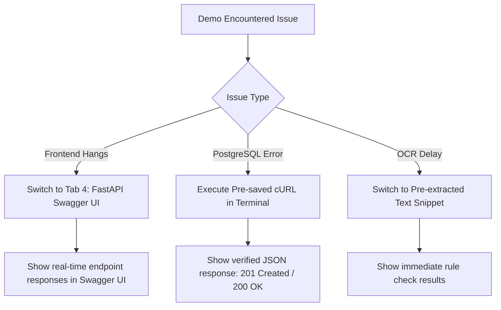

# BrandLedger: 3-Minute Hackathon Demo Script & Verification Checklist

**Project**: BrandLedger — Verifiable Brand Compliance & Content Passporting  
**Event**: Future Stack Hackathon  
**Author**: Umme Haany Tandur (Member 6: QA, Integration, Testing & Submission)  
**Target Duration**: 3 Minutes (180 Seconds)  
**Target Audience**: Hackathon Judges, Brand Compliance Directors, Marketing Leads  

---

## 1. Pre-Demo Preparation & Verification Checklist

Run through this checklist **15 minutes before** presenting to ensure the entire environment is warm, healthy, and pre-configured.

### 1.1 Infrastructure & Services Checklist

| Component | Target URL / Port | Verification Command / Check | Status |
|---|---|---|---|
| **PostgreSQL Database** | `localhost:5433` | `docker ps` &rarr; container `brandledger_postgres` healthy | [ ] |
| **Backend API (FastAPI)** | `http://localhost:8000` | `curl -s http://localhost:8000/health \| grep '"status":"ok"'` | [ ] |
| **API Documentation** | `http://localhost:8000/docs` | Swagger UI loads with Policy, Scan, Upload, Review, and Passport routes | [ ] |
| **Frontend UI (Next.js)** | `http://localhost:3000` | Landing page, Policy Library, and Brand Passport render cleanly | [ ] |
| **Tesseract OCR (Host)** | System CLI | `which tesseract` returns executable path | [ ] |

### 1.2 Browser Tabs Setup

Pre-open these browser tabs in a clean window (preferably 1080p, 100% zoom):

1. **Tab 1 — Creator Workspace / Landing**: `http://localhost:3000` (Platform overview) and `http://localhost:3000/workspace` (Scan integration boundary).
2. **Tab 2 — Policy Library**: `http://localhost:3000/policies` (Active policy cards, rule citations, and version history).
3. **Tab 3 — Brand Passport (Governance)**: `http://localhost:3000/brand-passport` (Brand identity guardrails and JSON export).
4. **Tab 4 — API Swagger Engine & Review Gateway**: `http://localhost:8000/docs` (Interactive live execution for `/api/scans`, `/api/reviews`, and `/api/passports/{id}`).

> [!NOTE]
> **Frontend Route Clarification**: The Next.js frontend implements Member 2's Policy Library (`/policies`) and Brand Identity Passport (`/brand-passport`), along with Member 1's Workspace integration boundary (`/workspace`). Dedicated human reviewer approval (`POST /api/reviews`) and Content Passport tamper verification (`GET /api/passports/{id}`) are implemented and executed in the FastAPI backend (`http://localhost:8000/docs`).

### 1.3 Pre-Staged Demo Data

Copy these exact snippets to a quick-access scratchpad before presenting:

#### Snippet A: Non-Compliant Draft (Triggers Rule Citations)
```text
Our customers can access the exclusive Summer Discount today!
```
- **Expected Findings** (evaluated against active policies at scan date `2026-07-01` or current date):
  - Finding 1: Cites `pol_term_001 v1.0` ("Brand Addressing Terminology") — Disallowed terminology `"customers"`, approved replacement `"Members"`. (Category: `terminology`, Severity: `high`/`blocker`, `is_verified: true`).
  - Finding 2: Cites `pol_offer_002 v1.0` ("Summer Discount Promotion Validity") — Offer `"Summer Discount"` expired on `2026-06-30`. (Category: `expired_offer`, Severity: `high`/`blocker`, `is_verified: true`).
- **Status**: `total_findings = 2`, `has_blockers = true` (blocks auto-approval; verified in backend integration test `test_api_scans.py:test_1`).

#### Snippet B: Corrected Compliant Draft (Clean Rescan)
```text
Our Members can access standard pricing today!
```
- **Expected Findings**: 0 findings, `has_blockers = false`, `status = "completed"`.
- **Status**: Compliant draft with zero blockers (verified in backend integration test `test_api_scans.py:test_3`).

#### File C: Sample Image with OCR
- Path: [backend/extraction_module/dataset/images/img_clear_offer.png](backend/extraction_module/dataset/images/img_clear_offer.png)
- Verified Dimensions / Size: 38 KB synthetic test image.
- Extracted Text: `"SPRING SALE - Get 20% OFF all Members plans - Valid until 31 March 2026 - Use code SPRING20"`.

---

## 2. Timed 3-Minute Demo Presentation Script

```
                               TIMELINE OVERVIEW
 0:00                0:45                1:30                2:15               3:00
  |-------------------|-------------------|-------------------|-------------------|
  Act 1: The Pitch    Act 2: Marketer     Act 3: Rescan &     Act 4: Reviewer     Act 5: Cryptographic
  & Core Tenet        Violation Scan      Evidence Citations  Approval Flow       Passport & Verification
```

---

### Act 1: The Problem & The Core Tenet (0:00 – 0:30) | 30 Seconds

- **Visual**: Tab 1 (`http://localhost:3000`) — BrandLedger landing page and core tenet banner.
- **Presenter Action**: Stand center, establish the problem with energy.

> **Speaker**:  
> *"Every modern brand faces a high-stakes bottleneck: marketing wants to move fast, but compliance teams reject creative assets with vague feedback like 'this doesn't feel on-brand' or 'check guidelines from three years ago.'  
> 
> The result? Endless revision cycles, accidental trademark violations, and zero audit trail.  
> 
> We built **BrandLedger** to solve this with a single, uncompromising rule: **'No receipt, no flag.'**  
> In BrandLedger, an automated scan cannot flag your content unless it cites the exact policy ID, the active version snapshot, and a literal verbatim source quote from the brand's rulebook. Let me show you how it works in practice."*

---

### Act 2: Marketer Upload & Scan with Real-Time Violations (0:30 – 1:15) | 45 Seconds

- **Visual**: Tab 1 (`http://localhost:3000/workspace`) or Tab 4 (Swagger UI `POST /api/scans`).
- **Presenter Action**: Paste **Snippet A** into the editor and execute the scan.

> **Speaker**:  
> *"I'm a marketer launching our campaign. I enter my proposed copy:  
> `'Our customers can access the exclusive Summer Discount today!'`  
> And I click **Scan Draft**."*

*(Presenter points at the scan results panel as findings populate instantly)*

> **Speaker**:  
> *"Look at the results. BrandLedger didn't just give a generic red banner. It produced two verifiable receipts:  
> 
> First, a **Terminology Blocker**: It flagged the word `'customers'` because Policy Card `pol_term_001` explicitly dictates: `'The brand prohibits the term Customers and requires the term Members'`. It even gives me the verified one-click replacement: `'Members'`.  
> 
> Second, an **Expired Offer Blocker**: Policy Card `pol_offer_002` establishes that the `'Summer Discount'` promotion was valid through June 30, 2026. Because our scan reference date is post-expiration, the offer is flagged as expired.  
> 
> Notice that each finding includes `is_verified: true`, confidence scoring, and an immutable snapshot of the active policy version at the exact second the scan occurred."*

---

### Act 3: Rescan & Compliance Resolution (1:15 – 1:50) | 35 Seconds

- **Visual**: Tab 1 (`http://localhost:3000/workspace`) or Tab 4 (Swagger UI `POST /api/scans`).
- **Presenter Action**: Edit the text box to **Snippet B** (`'Our Members can access standard pricing today!'`) with the existing `draft_id`, and click **Rescan**.

> **Speaker**:  
> *"Now, as a creator, I don't have to wait three days for an email reply. I fix the text right here: change 'customers' to 'Members' and adjust the expired offer to approved 'standard pricing'.  
> 
> I hit **Rescan**.  
> 
> Under the hood, BrandLedger maintains draft continuity via `draft_id`, but generates a distinct new scan record in PostgreSQL for complete audit traceability.  
> 
> And look at that: **Zero findings, zero blockers.** The scan status turns green.  
> The draft is now ready for formal human review."*

---

### Act 4: Reviewer Portal & Passport Generation (1:50 – 2:25) | 35 Seconds

- **Visual**: Tab 4 (Swagger UI `POST /api/reviews` or Reviewer dashboard).
- **Presenter Action**: Submit review decision with `X-User-Role: reviewer`, `decision: "approved"`, and comment: `'Approved for publication.'`

> **Speaker**:  
> *"Now let's switch hats to the compliance reviewer.  
> 
> In BrandLedger, review endpoints enforce role authorization. If a creator attempts self-approval using `X-User-Role: creator`, the engine strictly rejects it with HTTP 403 Forbidden.  
> 
> When an authorized reviewer submits `decision: 'approved'`, two critical things happen simultaneously:  
> 1. The draft status transitions from `draft` to `approved`.  
> 2. The backend cryptographically mints an official **Content Passport**."*

---

### Act 5: Content Passport & Tamper Verification (2:25 – 3:00) | 35 Seconds

- **Visual**: Tab 4 (Swagger UI `GET /api/passports/{passport_id}`).
- **Presenter Action**: Retrieve the issued Content Passport certificate.

> **Speaker**:  
> *"Here is the generated Content Passport.  
> It acts as a cryptographic certificate of authenticity for the published asset. It bundles the draft ID, scan ID, reviewer ID, timestamp, approved copy, applied policy versions, and a canonical **SHA-256 digital fingerprint**.  
> 
> If an ad agency, database administrator, or downstream publisher alters even a single character of the approved copy after the fact, our verification engine instantly detects the tampering.  
> 
> When we call `GET /api/passports/{id}`, the backend dynamically recomputes the SHA-256 hash across the frozen metadata snapshot and confirms: `hash_verified: true`. If tampered, `hash_verified` flips to `false`.  
> 
> That is **BrandLedger**: from creative draft to cryptographic passport, turning brand compliance from a friction point into a provable mathematical guarantee. Thank you!"*

---

## 3. Fallback & Contingency Plan (What If Live Services Fail?)

If live network or service issues occur during the demo, execute these seamless fallback actions without breaking presenter flow:



### Fallback 1: Frontend UI Unresponsive &rarr; Live Swagger UI (Tab 4)
- **Action**: Switch immediately to `http://localhost:8000/docs`.
- **Narration**: *"Our frontend provides the visual layer, but let me show you the raw API engine in real time."*
- **Execution**: Expand `POST /api/scans` &rarr; click **Try it out** &rarr; paste Snippet A &rarr; click **Execute**. Show the live JSON response containing `findings`, `source_quote`, and `is_verified: true`.

### Fallback 2: OCR Extraction Latency on High-Res Uploads
- **Cause**: Tesseract CPU processing on large images takes 2–4 seconds.
- **Action**: Use the pre-tested synthetic image [img_clear_offer.png](backend/extraction_module/dataset/images/img_clear_offer.png) (38KB, processes in under 500ms) or switch immediately to typed text.

### Fallback 3: Live Verification Pre-staged cURL
Run this pre-verified cURL command in a pre-opened terminal window:

```bash
# Emergency health check (returns {"status":"ok","service":"brandledger-api"})
curl -s http://localhost:8000/health

# Emergency direct scan (triggers terminology and expired_offer findings)
curl -s -X POST http://localhost:8000/api/scans \
  -H "Content-Type: application/json" \
  -d '{"title": "Emergency Demo", "content_text": "Our customers can access the exclusive Summer Discount today!"}'
```

---

## 4. Judges Q&A Defense Matrix

Anticipated questions from technical and business hackathon judges, with authoritative answers grounded in the actual codebase:

| Question / Topic | Grounded Technical Answer | Reference Code |
|---|---|---|
| **"How do you prevent false-positive hallucinated compliance flags?"** | BrandLedger enforces the **"No receipt, no flag"** tenet. Findings are strictly discarded unless they bind to an existing database `policy_card_id`, cite an exact `policy_version`, and contain a verbatim substring from `source_quote` matching the policy rule text. | [evidence_verifier.py:27-60](backend/app/services/evidence_verifier.py#L27-L60) |
| **"What is the Content Passport and does it prevent database tampering?"** | The Content Passport creates a canonical SHA-256 fingerprint over the frozen JSON snapshot (keys sorted, compact separators) of approved content, reviewer ID, timestamp, and cited policy versions. On retrieval, `GET /api/passports/{id}` recomputes the SHA-256 hash dynamically and sets `hash_verified = True/False`. It provides **tamper detection** — if an unauthorized actor directly edits the database record, `hash_verified` evaluates to `False`. | [review_service.py:26-41](backend/app/services/review_service.py#L26-L41), [review_service.py:214-256](backend/app/services/review_service.py#L214-L256) |
| **"How does the OCR & File Extraction pipeline work?"** | Uploads accept PNG, JPG, WEBP, BMP, TIFF, and PDF. PyMuPDF extracts existing text layers; if unavailable or scanned, Tesseract OCR processes the raster. The pipeline flags low resolution, blur, low contrast, and logo similarity candidates without making legal policy decisions. | [file_processing.py](backend/extraction_module/brandledger_extraction/file_processing.py), [ocr_service.py](backend/extraction_module/brandledger_extraction/ocr_service.py) |
| **"How do you handle policy updates without invalidating old scans?"** | When a policy is updated, a new entry is recorded in `policy_card_versions` with an incremented version (e.g., `2`). Scans persist the exact `policy_version` string evaluated at scan time. Older scans remain historical proof under the policy version that was active when they were scanned. | [policies.py:160-245](backend/app/api/policies.py#L160-L245) |
| **"Can a content creator approve their own submission?"** | The Review API validates role headers. Requests submitted with `X-User-Role: creator` are rejected with HTTP 403 Forbidden. Only authorized roles (`reviewer` or `admin`) can record approvals and trigger passport issuance. Note: This header represents simulated role-based authorization for hackathon evaluation, distinct from production authentication (e.g. OAuth2/OIDC/JWT). | [reviews.py:30-50](backend/app/api/reviews.py#L30-L50) |
| **"Which components exist in Next.js UI versus FastAPI backend?"** | The Next.js frontend implements Member 2's Policy Library (`/policies`) and Brand Passport governance view (`/brand-passport`), plus Member 1's scan workspace boundary (`/workspace`). The review approval gate and Content Passport issuance/retrieval are hosted on FastAPI and demonstrated via Swagger UI (`http://localhost:8000/docs`). | [frontend/src/app](frontend/src/app), [backend/app/main.py](backend/app/main.py) |

---

## 5. Team Contribution Summary (Submission Slide Reference)

| Member | Primary Responsibility | Key Deliverables Demonstrated in Demo |
|---|---|---|
| **Sana Fria** | Frontend Architecture & Scan Workspace (Member 1) | Interactive draft submission, real-time finding highlights & reviewer workflow specification (`/workspace`). |
| **Nimra Tariq** | Policy Library & Brand Passport UI (Member 2) | Authoritative brand policy management, versioning panel, brand voice pillars & governance passport (`/policies`, `/brand-passport`). |
| **Zoya Nadeem** | Backend API, Database Persistence & Review Engine (Member 3) | FastAPI route orchestration, PostgreSQL schema/migrations, scan/review persistence, and Content Passport issuance. |
| **Zynab Farhan** | Deterministic Rules Engine & Evidence Verification (Member 4) | "No receipt, no flag" rule checks (terminology, expired offers, numerical limits, unsupported claims), evidence verifier. |
| **Mahadevi Sabarad** | Extraction & Visual OCR Module (Member 5) | Multi-format file extractor (PDF/images), Tesseract OCR integration, visual quality warning flags. |
| **Umme Haany Tandur** | QA, Integration, Documentation & Submission Lead (Member 6) | Acceptance test suite, test audit & negative tests, system architecture docs, demo script & verification checklist. |
